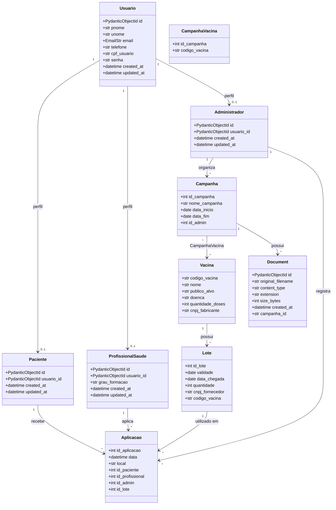

# VacinaSys API

API Web para gerenciamento de um sistema de vacinação, construída com **FastAPI**,
**MongoDB** (driver assíncrono) e o ODM **Beanie**. O armazenamento dos arquivos
(documentos das campanhas) é feito no **MinIO**, mantendo no MongoDB apenas os
metadados. Todo o ambiente é orquestrado via **Docker Compose**.

## Tecnologias

- **FastAPI** — construção da API e documentação automática (OpenAPI/Swagger).
- **MongoDB** — banco de dados de documentos.
- **Beanie** — ODM assíncrono compatível com Pydantic.
- **MinIO** — armazenamento de objetos (arquivos físicos).
- **fastapi-pagination** — paginação das listagens.
- **uv** — gerenciamento de dependências e execução.
- **Docker / Docker Compose** — orquestração dos serviços.

## Estrutura do projeto

```
vacinasys-api-docker/
├── app/
│   ├── config.py          # Configurações via .env (Pydantic Settings)
│   ├── database.py        # Inicialização do MongoDB e do Beanie
│   ├── main.py            # Instância FastAPI, lifespan e routers
│   ├── models/            # Entidades (Documentos Beanie)
│   ├── schemas/           # Modelos Pydantic de entrada/saída
│   ├── routes/            # Endpoints da API
│   └── service/           # Regras de negócio (MinIO, documentos)
├── scripts/
│   └── seed.py            # População do banco com dados realistas (Faker pt_BR)
├── Dockerfile
├── docker-compose.yaml
├── .env / .env.example
├── pyproject.toml / uv.lock / .python-version
└── README.md
```

## Diagrama de classes



### Relacionamentos

- **Um-para-muitos (1:N):** `Vacina → Lote`, `Lote → Aplicacao`,
  `Administrador → Campanha` e `Campanha → Document`.
- **Muitos-para-muitos (N:N):** `Campanha ↔ Vacina`, representado pela associação
  `CampanhaVacina`.
- **Um-para-um (1:1, opcional):** um `Usuario` pode ter, no máximo, um perfil de
  `Paciente`, `ProfissionalSaude` ou `Administrador`.

## Como executar

A aplicação sobe completa com um único comando, já conectada ao MongoDB e ao MinIO.

### 1. Configurar variáveis de ambiente

Copie o arquivo de exemplo e ajuste se necessário:

```bash
cp .env.example .env
```

O `.env` traz as URLs do MongoDB **Docker**, **local** e **Atlas** — basta deixar
ativa apenas a linha `MONGODB_URL` desejada (as demais permanecem comentadas).
Nenhuma credencial fica fixa no `docker-compose.yaml` nem no código.

### 2. Subir os serviços

```bash
docker compose up --build
```

Serviços orquestrados:

| Serviço | Porta(s) | Descrição |
|---------|----------|-----------|
| `api`   | 8000     | Back-end FastAPI |
| `mongo` | 27017    | MongoDB (volume `mongo-data`) |
| `minio` | 9000 / 9001 | Armazenamento de objetos (API / Console; volume `minio-data`) |

Os contêineres se comunicam pela rede interna do Compose, referenciando-se pelos
nomes dos serviços (`mongo`, `minio`) — nunca por `localhost`.

### 3. Acessar

- **API / Swagger:** http://localhost:8000/docs
- **Console do MinIO:** http://localhost:9001
  (usuário/senha definidos em `MINIO_ROOT_USER` / `MINIO_ROOT_PASSWORD`)

### 4. Popular o banco (seed)

Com os contêineres no ar, em outro terminal:

```bash
docker compose exec api uv run python scripts/seed.py
```

O script usa **Faker (pt_BR)** e gera no mínimo 100 registros por entidade,
respeitando os relacionamentos e lendo as configurações do `.env`.

## Documentos, MinIO e metadados

Cada documento é associado a uma campanha. O **arquivo físico** vai para o MinIO e o
**MongoDB guarda apenas os metadados** na coleção `documents`. O `id` do documento é
usado como nome físico do objeto no bucket.

A entidade `Document` possui, no mínimo: `id`, `original_filename`, `content_type`,
`extension`, `size_bytes` e `created_at`.

### Endpoints de documentos

| Método | Rota | Descrição |
|--------|------|-----------|
| `POST`   | `/campanhas/{campanha_id}/documents` | Envia um novo documento para a campanha |
| `GET`    | `/campanhas/{campanha_id}/documents` | Lista (paginado) os documentos da campanha |
| `GET`    | `/documents/{document_id}` | Retorna os metadados do documento |
| `GET`    | `/documents/{document_id}/download` | Baixa ou exibe o arquivo |
| `PUT`    | `/documents/{document_id}` | Substitui o arquivo do documento |
| `DELETE` | `/documents/{document_id}` | Remove o documento e o arquivo físico |

O upload é resiliente: se a gravação no MinIO falhar após inserir os metadados,
o registro correspondente é removido do MongoDB (rollback), evitando órfãos.

## Documentação da API

Com a aplicação no ar, a documentação interativa (OpenAPI/Swagger) fica disponível
em http://localhost:8000/docs e o schema em http://localhost:8000/openapi.json.